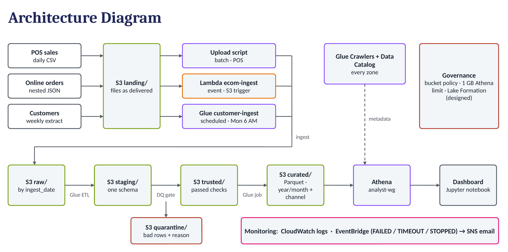

# Thornquist Outfitters – Governed Data Lake

CCGC 5506 Mid-Term Project 1 · Team: **Ruchi Patel** (ingestion & ETL) · **Sukrutha Srirangam** (quality, analytics & governance)

A zoned S3 data lake (landing → raw → staging → trusted / quarantine → curated) that combines Thornquist's
in-store POS sales, e-commerce orders and legacy customer extract, built with S3, Lambda, AWS Glue,
Athena and Lake Formation in AWS Academy Learner Lab (us-east-1, bucket `thornquist-lake-764541939057`).

## Headline results (sample week Aug 24–30, 2026)

| Finding | Value |
|---|---|
| Online vs in-store average order value | **$469.06 vs $204.73 (2.3×)** |
| Online revenue quarantined by the quality gate | **$20,319 (16.1%)**: 35 orders from customers that don't exist, 5 orders re-sent by webhook |
| Store revenue from anonymous walk-ins | **16.6%** (British Columbia highest at 21.6%) |
| Gold loyalty members online | spend **less** per order ($347) than Standard members ($459) |
| Curated Parquet vs CSV (same query) | **98.6% less data scanned** (3.03 KB vs 224.43 KB) |
| Pipeline cost per weekly run | about **$0.10–0.15**, nothing always-on |

## Architecture



## Zones and promotion rules

| Zone | Holds | Written by | Rule to enter the zone |
|---|---|---|---|
| `landing/` | Files exactly as delivered | Upload script, manual upload | None: the original copy is kept untouched |
| `raw/` | As-received copy, partitioned by `ingest_date=` | Lambda `ecom-ingest`, `upload_pos.sh`, Glue `customer-ingest` | File arrived and is readable; no fixes or deduplication |
| `staging/` | One conformed sales model + customers (Parquet) | Glue `raw-to-staging` | Formats conformed (schema conflicts below); data problems deliberately passed through |
| `trusted/` | Lines that passed every quality rule (Parquet) | Glue `dq-gate` | Passes all 7 data quality rules |
| `quarantine/` | Lines that failed, with `dq_reason`, one folder per run | Glue `dq-gate` | Failed at least one rule; never deleted |
| `quality/` | Rows and revenue per rule per run, rule self-test results | Glue `dq-gate` | Written on every run |
| `curated/` | `sales_fact` + `customer_dim`, Parquet, partitioned by year/month/channel | Glue `trusted-to-curated` | Built only from trusted data |

## Ingestion: three patterns

| Source | Pattern | Component |
|---|---|---|
| E-commerce orders (JSON array) | Event-driven | Lambda `ecom-ingest`, S3 trigger on `landing/ecommerce/*.json`; converts to JSON Lines and adds `_source_file`, `_ingest_ts` |
| POS sales (daily CSV) | Scripted batch upload | `ingestion/upload_pos.sh` |
| Customer extract (weekly flat file) | Scheduled batch | Glue Python shell job `customer-ingest`, every Monday 06:00 UTC |

## Schema conflicts resolved (`glue/raw_to_staging.py`)

| # | Conflict | POS | E-commerce | Fix in staging |
|---|---|---|---|---|
| 1 | Date format | `YYYY-MM-DD`; 33 rows use `DD/MM/YYYY` | ISO timestamp `2026-08-24T14:32:00Z` | One `sale_date` (DATE); original kept in `sale_date_original` |
| 2 | Customer key | `cust_num` text; 185 walk-ins as `0000000` | `cust_ref` number | Both become `cust_num` text; walk-ins get `is_walk_in = true` |
| 3 | Structure | One row per item | Nested `items` array (265 orders, 654 lines) | Items exploded to one row each, with `line_number` |
| 4 | Product taxonomy | `category` column | SKU prefix only (CAM, ACC, FOO, APP) | Prefix mapped to Camping, Accessories, Footwear, Apparel |
| 5 | Region and channel | Store region, no channel | `shipping_region` | Both become `region`; `channel` = in-store / online |
| 6 | Dirty text | 13 product names with stray / non-breaking spaces, Windows line endings | – | Cleaned and trimmed |

The raw POS table is defined by hand (`sql/01_create_raw_pos_sales.sql`) because a crawler would read
`cust_num` as a number and turn the walk-in marker `0000000` into `0`.

## Data quality, curated layer, analytics, governance

| Topic | Details |
|---|---|
| Data quality gate (7 rules, quarantine, rule self-test, cost of bad data) | [`docs/data_quality.md`](docs/data_quality.md) |
| Curated model, partitioning, cost per run | [`docs/curated_and_cost.md`](docs/curated_and_cost.md) |
| CSV vs Parquet benchmark (bonus) | [`docs/benchmark.md`](docs/benchmark.md) |
| Business queries (Q1–Q6) and quality queries (QA1–QA4) | [`sql/`](sql/) |
| Dashboard (Jupyter notebook on Athena; QuickSight not used for cost) | [`notebook/dashboard.ipynb`](notebook/dashboard.ipynb), charts in [`notebook/charts/`](notebook/charts/) |
| IAM policies, bucket policy, Lake Formation grants, RACI | [`governance/`](governance/) |
| Screenshots of every stage (43 figures) | [`evidence/Thornquist_Evidence_Screenshots.pdf`](evidence/Thornquist_Evidence_Screenshots.pdf) |

**Monitoring:** EventBridge rule `glue-job-failure` (any Glue job FAILED / TIMEOUT / STOPPED) sends an
email through SNS topic `thornquist-pipeline-alerts`. The quality gate's self-test fails the job on purpose
if a rule stops working, which triggers the same alert.

## Setup: rebuild from a fresh Learner Lab session

Learner Lab blocks IAM role creation, so every service runs as **LabRole**. Run in **CloudShell** (us-east-1)
unless a step says console. These are the commands used to build the lab on Oct 17–22, 2026.

```bash
git clone https://github.com/sukruthasrirangam/thornquist-data-lake-SR.git ~/thornquist-data-lake-SR
cd ~/thornquist-data-lake-SR
export BUCKET=thornquist-lake-$(aws sts get-caller-identity --query Account --output text)
export ROLE=$(aws iam get-role --role-name LabRole --query Role.Arn --output text)
```
If you use a different bucket name, replace `thornquist-lake-764541939057` in `ingestion/`, `glue/customer_ingest.py`,
`glue/raw_to_staging.py`, `sql/` and `governance/`.

**1. Bucket and zones**
```bash
aws s3 mb s3://$BUCKET
for z in landing/pos landing/ecommerce landing/customers raw staging trusted quarantine quality curated benchmark athena-results scripts; do
  aws s3api put-object --bucket $BUCKET --key $z/; done
```

**2. POS ingestion (scripted)**
```bash
bash ingestion/upload_pos.sh
```

**3. E-commerce ingestion (Lambda, console)**
Lambda → Create function `ecom-ingest`, Python 3.12, existing role **LabRole** → paste
`ingestion/ecom_ingest_lambda.py` → Deploy → Configuration → timeout 30 s → Add trigger: S3, bucket `$BUCKET`,
all object create events, prefix `landing/ecommerce/`, suffix `.json`. Then:
```bash
aws s3 cp data/ecommerce_orders.json s3://$BUCKET/landing/ecommerce/
```

**4. Customer ingestion (scheduled Glue job)**
```bash
aws s3 cp data/customer_extract.csv s3://$BUCKET/landing/customers/
aws s3 cp glue/customer_ingest.py s3://$BUCKET/scripts/
aws glue create-job --name customer-ingest --role $ROLE --max-capacity 0.0625 \
  --command Name=pythonshell,ScriptLocation=s3://$BUCKET/scripts/customer_ingest.py,PythonVersion=3.9
aws glue start-job-run --job-name customer-ingest
aws glue create-trigger --name customer-ingest-weekly --type SCHEDULED \
  --schedule "cron(0 6 ? * MON *)" --actions JobName=customer-ingest --start-on-creation
```

**5. Raw catalog**
```bash
aws glue create-database --database-input Name=thornquist_raw
aws glue create-crawler --name raw-crawler --role $ROLE --database-name thornquist_raw \
  --targets "{\"S3Targets\":[{\"Path\":\"s3://$BUCKET/raw/ecommerce/\"},{\"Path\":\"s3://$BUCKET/raw/customers/\"}]}"
aws glue start-crawler --name raw-crawler
```
Then in Athena run `sql/01_create_raw_pos_sales.sql` (manual POS table). Expected counts: 1,051 POS rows, 265 orders, 400 customers.

**6. raw → staging ETL**
```bash
aws s3 cp glue/raw_to_staging.py s3://$BUCKET/scripts/
aws glue create-job --name raw-to-staging --role $ROLE \
  --command Name=glueetl,ScriptLocation=s3://$BUCKET/scripts/raw_to_staging.py,PythonVersion=3 \
  --glue-version 4.0 --worker-type G.1X --number-of-workers 2 --timeout 10
aws glue start-job-run --job-name raw-to-staging
aws glue create-database --database-input Name=thornquist_staging
aws glue create-crawler --name staging-crawler --role $ROLE --database-name thornquist_staging \
  --targets "{\"S3Targets\":[{\"Path\":\"s3://$BUCKET/staging/sales_lines/\"},{\"Path\":\"s3://$BUCKET/staging/customers/\"}]}"
aws glue start-crawler --name staging-crawler
```
Expected: 1,705 sales lines (1,051 in-store + 654 online), 400 customers.

**7. Failure alerts**
```bash
TOPIC=$(aws sns create-topic --name thornquist-pipeline-alerts --query TopicArn --output text)
aws sns subscribe --topic-arn $TOPIC --protocol email --notification-endpoint you@example.com   # confirm the email
aws sns set-topic-attributes --topic-arn $TOPIC --attribute-name Policy --attribute-value \
  "{\"Version\":\"2012-10-17\",\"Statement\":[{\"Effect\":\"Allow\",\"Principal\":{\"Service\":\"events.amazonaws.com\"},\"Action\":\"sns:Publish\",\"Resource\":\"$TOPIC\"}]}"
aws events put-rule --name glue-job-failure --event-pattern \
  '{"source":["aws.glue"],"detail-type":["Glue Job State Change"],"detail":{"state":["FAILED","TIMEOUT","STOPPED"]}}'
aws events put-targets --rule glue-job-failure --targets "Id"="sns-alert","Arn"="$TOPIC"
```

**8. Quality gate, curated layer, queries, benchmark, governance**
Follow [`docs/run_sheet_quality_and_curated.md`](docs/run_sheet_quality_and_curated.md) steps 1–8
(creates `dq-gate` and `trusted-to-curated`, the trusted / quality / curated crawlers, the `analyst-wg`
workgroup, the benchmark tables and the bucket policy).

**Before logging off:** stop any running crawlers and notebooks; nothing else costs money between runs.

## Repository layout

| Folder | Contents |
|---|---|
| `data/` | Instructor sample data; `data/demo/` holds the bad batch used in the quality-gate demo |
| `docs/` | Architecture diagram, data quality, curated layer and cost, benchmark, run sheet, presentation notes |
| `ingestion/` | POS upload script, e-commerce Lambda |
| `glue/` | `customer_ingest.py`, `raw_to_staging.py`, `dq_gate.py`, `trusted_to_curated.py` |
| `sql/` | Manual raw table, business queries, quality queries, benchmark |
| `governance/` | IAM policies, bucket policy, Lake Formation grants, RACI |
| `notebook/` | Dashboard notebook and chart images |
| `evidence/` | Screenshots of every stage (PDF) |
